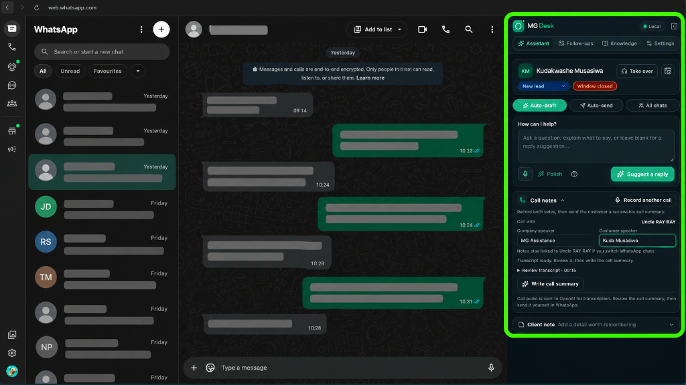
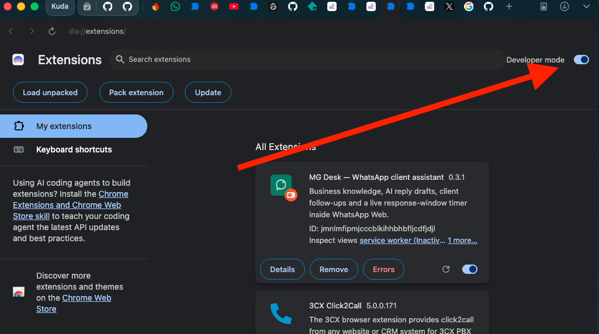
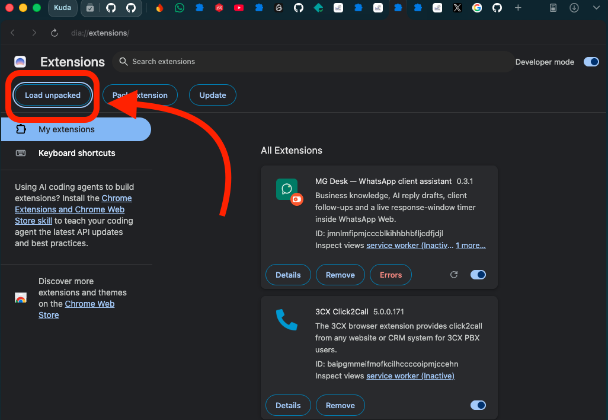
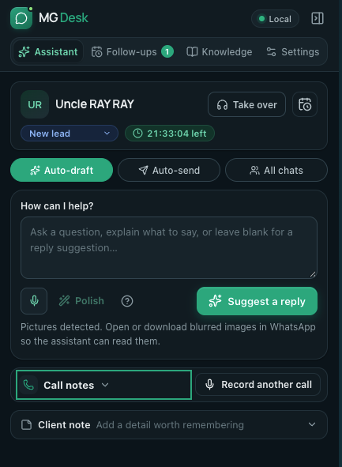
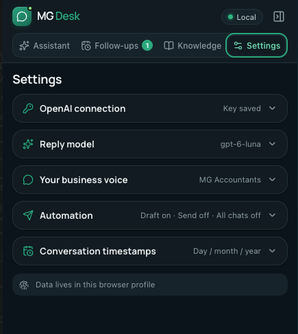
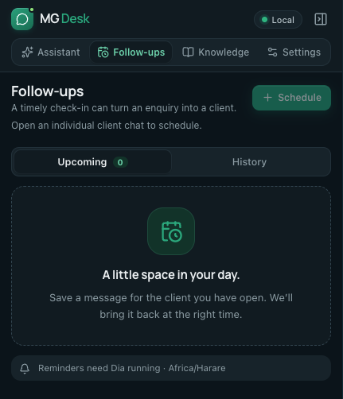

# Desk AI for WhatsApp Web

An open-source Chrome extension that puts business knowledge, AI reply drafts and follow-ups beside WhatsApp Web. Built by **Kudakwashe Musasiwa**, the initial author. Licensed under the [MIT License](LICENSE).

Bring your own API credentials and business information. No provider credentials, customer data or business knowledge are supplied. Provider usage is billed by the provider/account owner. Automatic drafting and sending are off by default.



*The shared Desk AI panel design inside WhatsApp Web, shown here in the MG Desk deployment.*

## Feature highlights

- **Live 24-hour response timer:** see hours, minutes and seconds remaining from the latest observed customer message, with clear open/closed status to help manage follow-ups.
- **WhatsApp Business setup by QR code:** keep using your existing WhatsApp Business account through WhatsApp Web. Scan its QR code from your phone; Desk AI needs no Meta Business Manager or WhatsApp Cloud API setup.
- **AI replies that know your business:** upload your services, prices, policies and FAQs, then draft answers grounded in your own documents.
- **Picture and receipt understanding:** read loaded photos, screenshots and proofs of payment in the context of the conversation, with human review for unclear details or mismatches.
- **Call and meeting notes:** record the audio of WhatsApp voice and video calls, transcribe with your selected speech provider, then send the customer an editable call summary — a thank-you, what was discussed, agreed next steps and anything still to confirm. Name the company and customer speakers for better transcripts and attribution.
- **Voice replies with AI polish:** dictate WhatsApp replies with speech-to-text, then polish the wording — professional, shorter, clearer or summarized — before pressing Send.
- **Compact desk layout:** the composer, client details, automation chips, queue and call notes are designed to stay on screen without scrolling.
- **Follow-ups and human takeover:** save client notes, schedule reminders and pause automation when a person needs to step in.
- **Your keys, your control:** connect OpenAI, OpenRouter, Kimi (Moonshot), DeepSeek, Anthropic, Google Gemini or xAI Grok. Review drafts before sending and enable optional automation only when you are ready.

## Install — no coding needed

1. Download **WhatsApp-Desk.zip** from the [latest release](https://github.com/kudamusaisiwa/whatsapp-desk/releases/latest).
2. Unzip it and keep the extracted **WhatsApp Desk** folder somewhere permanent.
3. In desktop Chrome, open `chrome://extensions` and turn on **Developer mode**.
4. Click **Load unpacked** and select **`WhatsApp Desk/releases/WhatsApp-Desk`** inside the unzipped download.
5. Open or refresh [WhatsApp Web](https://web.whatsapp.com). Desk AI appears on the right.
6. Open **Settings**, choose a provider for each AI task, enter your own provider API key and save. Refresh the model list or enter a compatible model ID.
7. Set your business name and reply style, then add approved documents or notes in **Knowledge**.
8. Open an individual chat and choose **Draft a reply**. Review the draft in WhatsApp before sending.

**“Manifest file is missing or unreadable”?** Chrome needs the folder with `manifest.json` directly inside it. Download the release asset named **WhatsApp-Desk.zip**, rather than GitHub’s **Source code (zip)**. If you are loading this source project after building it, select its **`dist/`** folder; the source project root is not an installable extension. A packaged build is also available in **`releases/WhatsApp-Desk/`** after `npm run package:share`.

Keep Developer mode enabled and keep the installed folder. Chrome 120 or later is required. Managed work browsers may require administrator approval. This is a manual installation with manual updates, rather than a Chrome Web Store listing.

The ZIP includes a [visual setup guide](sharing/START-HERE.html) and [plain-text instructions](sharing/START-HERE.txt) covering setup, troubleshooting and updates. Chrome documents this installation flow in its [official extension guide](https://developer.chrome.com/docs/extensions/get-started/tutorial/hello-world).

### Link your WhatsApp Business account

Open [WhatsApp Web](https://web.whatsapp.com). On your phone, open **WhatsApp Business → Linked devices → Link a device**, then scan the QR code shown on your computer. After linking, the extension works beside your chats. See [WhatsApp’s official QR linking guide](https://faq.whatsapp.com/878854700132604/) for the phone-specific steps.

### Installation examples

These examples show Dia with the earlier MG Desk name. For Chrome, open `chrome://extensions` and use the **Developer mode** and **Load unpacked** controls shown below. The extracted release folder keeps its existing `WhatsApp Desk` path for easy installation.

**1. Turn on Developer mode.**



**2. Click Load unpacked, then select `WhatsApp Desk/releases/WhatsApp-Desk`.**



### Latest design

The same panel design ships in Desk AI; these captures are shown in the MG Desk deployment.

| Assistant | Settings | Follow-ups |
|---|---|---|
|  |  |  |

## What it does

- **Business knowledge:** add PDF, DOCX, TXT, Markdown, CSV or JSON files, or write notes. Text extraction happens locally. Scanned PDFs need OCR first. Maximum 10 MB and 300,000 extracted characters per document; 2 million characters across the library.
- **AI replies:** grounded drafts use relevant business excerpts and up to 35 recent visible messages. Choose independent providers and models for replies/general assistant, picture understanding, polish, call summaries and transcription. Compatibility depends on the selected model.
- **Pictures and screenshots:** include up to six loaded images per draft, resized to a maximum 2048 px edge. Receipts can be read and compared with approved payment details; images cannot independently verify payment or authenticity. Unclear or mismatched images require review.
- **Client workspace:** local notes, stages, human takeover controls and a follow-up queue with review reminders and optional automatic sending.
- **24-hour response timer:** a live hours/minutes/seconds countdown from the latest observed incoming customer message. Business replies do not restart it. It is a workflow aid, not a connection to the WhatsApp Business Platform.
- **Optional automation:** draft when messages arrive, automatically send eligible replies, and watch the newest visible inbox rows across chats. These controls start off. Review flags, human typing/takeover, changed conversations and uncertain sends pause automation.

## Privacy and keys

Provider keys are entered at runtime and saved in `chrome.storage.local`, restricted to trusted extension contexts. They are not synced, returned in panel state or passed to the WhatsApp webpage. The extension sends each key to its selected provider as required for authentication. Local storage is not independently encrypted; someone with access to the browser profile or extension developer tools may retrieve credentials. Remove saved keys in Settings.

When you run a task, the selected provider receives only the data needed for that task. Drafting can send relevant business excerpts, recent visible chat messages and included pictures; image understanding requires a compatible model. Polishing sends only the selected operator text. Call summaries send the transcript and the business/participant/speaker names you provide. Dictation and call transcription send audio after you start those actions. Each provider's privacy, retention and usage terms apply. The extension does not send AI content to the licensing service and does not load remote JavaScript. Knowledge, notes, follow-ups, settings and keys belong to this browser profile. Removing the extension clears its local data.

Optional voice dictation starts only when you click the microphone and grant browser access. The recording is sent to the provider selected for dictation transcription; it is not saved by the extension. The transcript appears in the editable panel and syncs to the selected WhatsApp composer. You can polish it with the independently selected polish route; review the result and press WhatsApp's Send button yourself. Changes in the panel mirror to the composer only while it still matches the text Desk last placed. Typed AI questions and suggestions remain in the panel.

A panel-only suggestion for the open chat has an **Insert into chat** button that places it in WhatsApp's empty message box for review. It uses the same compare-and-set write as dictation, refuses a box that already has text, and never sends the message.

Call recording is a separate action you start manually during an active WhatsApp Web call. Chrome asks you to choose the WhatsApp tab and enable **Share audio**; the extension records that tab audio together with your microphone, for up to 60 minutes and 20 MiB. No video is recorded, and the audio is not saved by the extension. You can name the company and customer speakers for a better transcript and summary. After you stop, the audio is sent to the provider selected for call transcription with any business, participant and speaker names used as transcription hints. For the optional customer-facing summary, the transcript and names are sent to the separately selected summary provider. The transcript and summary stay editable in the panel and can sync only to the original caller chat while the WhatsApp composer still matches the last synchronized text. Nothing is sent automatically.

OpenAI, OpenRouter, Kimi (Moonshot), DeepSeek, Anthropic, Google Gemini and xAI Grok API credentials are supported. Which models and tasks work depends on provider access and model capabilities; see [AI providers and model routing](docs/ai-providers.md). API usage is charged by the applicable provider/account and does not come with this extension. OpenAI API billing is [separate from a ChatGPT subscription](https://help.openai.com/en/articles/9039756-managing-billing-for-chatgpt-and-the-api-platform). Desk AI does not currently offer Sign in with ChatGPT or ChatGPT-plan inference. It does not generate images or speech audio (TTS). Never put a real key in source code, screenshots, issues or shared files.

## Practical limits

Chrome must be running, the computer awake, and WhatsApp signed in for timely automation. Reminders recover when the browser resumes. The inbox monitor watches the newest rendered rows without scrolling or changing filters; keep the All inbox at the top for coverage. It does not retrieve the complete account history or monitor Archived chats. Groups and human-takeover chats are excluded from automatic replies.

The assistant reads visible page elements. WhatsApp interface changes can require updates. Photos must be loaded in the chat. Voice notes, videos and document attachments from conversations are not read. Existing human text is preserved, and automatic sends require a known open response window and an unchanged conversation. Scheduled automatic follow-ups require their exact chat open.

The current automated checks use simulated extension and WhatsApp fixtures. They do not establish live compatibility with every Chrome or WhatsApp version. This is an independent project, not an official Meta/WhatsApp product.

## Development

Use Node.js 22.12 or later.

```sh
npm ci
npm run check
```

Load the generated `dist/` folder through Chrome's **Load unpacked** button. For a fictional design preview:

```sh
npm run dev -- --port 4187
```

Open `http://127.0.0.1:4187`. The preview cannot save real provider credentials, call AI providers or send WhatsApp messages.

`npm run check` runs TypeScript, unit/integration tests and the production build. Tests cover local key isolation, fresh-install defaults, knowledge retrieval, image/receipt handling, chat identity, composer insertion, inbox monitoring, reply timing and automatic-send safeguards.

## Build a shareable ZIP

Install [Gitleaks](https://github.com/gitleaks/gitleaks), plus the `zip` and `unzip` command-line utilities, then run:

```sh
npm run check
npm run package:share
```

The packaging command builds from source, includes installation guides, the MIT license and third-party license notices, permits only expected extension files, scans the built folder and ZIP for secrets, tests ZIP integrity and writes a SHA-256 checksum. It stops if scanning fails or an unexpected file is present. No browser profile, local configuration, `.env`, Git history, customer records or source tree is packaged.

Outputs:

- `releases/WhatsApp-Desk.zip` — share this file.
- `releases/WhatsApp-Desk.zip.sha256` — integrity checksum.
- `releases/WhatsApp-Desk-audit.json` — scan summary and file inventory.


## Provider implementation notes

See [AI providers and model routing](docs/ai-providers.md) for task routes, capability limits, data flows and the status of ChatGPT plan usage. The [multi-provider implementation plan](docs/multi-provider-plan.md) records the compatibility matrix and release verification gates.

## Contributing and license

See [CONTRIBUTING.md](CONTRIBUTING.md). Report security concerns using [SECURITY.md](SECURITY.md).

Copyright (c) 2026 **Kudakwashe Musasiwa**, initial author. The [MIT License](LICENSE) permits use, modification and redistribution while retaining its copyright and permission notice. Dependencies and fonts retain their own licenses; release ZIPs include their notices in `THIRD-PARTY-NOTICES.txt`.
